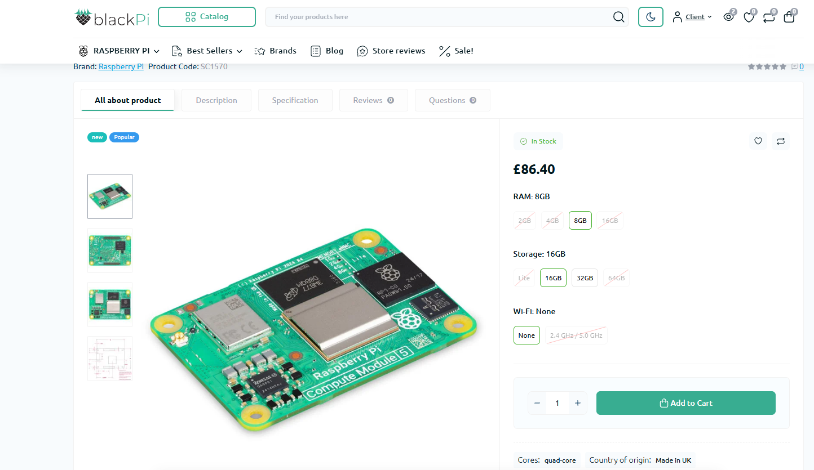

# November 7: Planning

Happy Deepavali!
I spent a good hour of my morning researching what I want to include in my board.

What I know so far:
- I want it to be in the form factor of a phone, between 5 inches and 6.9 inches.
- I want it to be modular
- It needs to be able to act both as a standalone tool as well as a tool to be paired with my laptop
- It needs to fall under $200
- It needs to run anything I need it to run for pen-testing

With the general idea of what I want in my head, I searched for some possible chipsets to use.
I initially wanted the Radxa CM5, just because it's AMAZING as a SoM board... they were out of stock.
I decided to go with a Raspberry Pi CM5 instead. Alternatives.

**Total time spent: 1 hours**